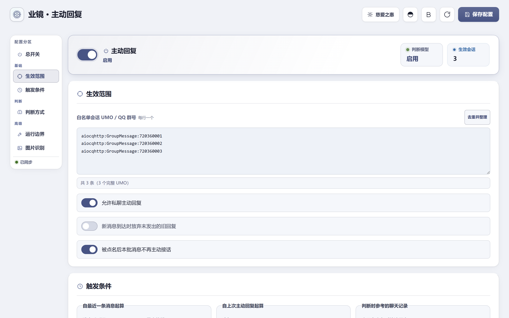
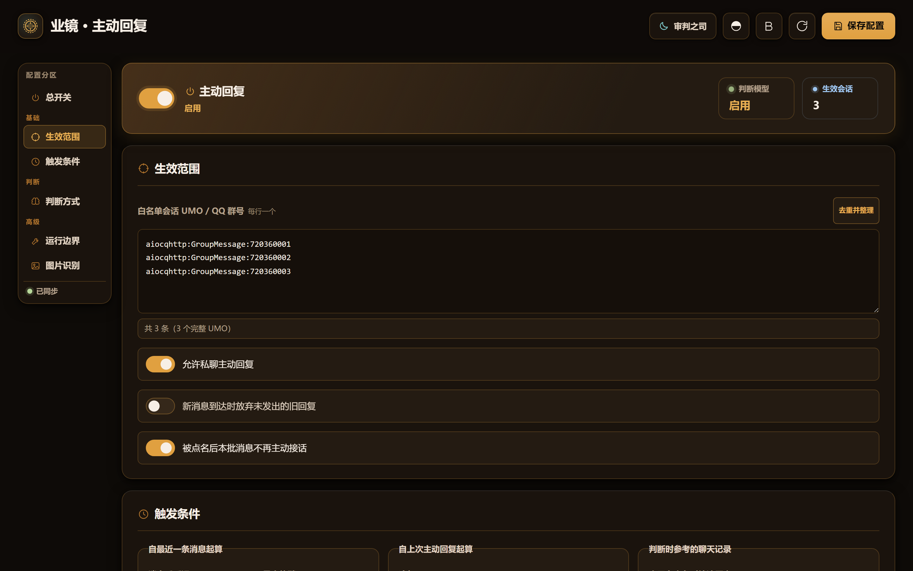

<p align="center">
  <picture>
    <source media="(prefers-color-scheme: dark)" srcset="https://raw.githubusercontent.com/chengzhi-c/astrbot_plugin_self_initiated_reply/main/assets/banner-dark.jpg">
    <source media="(prefers-color-scheme: light)" srcset="https://raw.githubusercontent.com/chengzhi-c/astrbot_plugin_self_initiated_reply/main/assets/banner-light.jpg">
    
  </picture>
</p>

<h1 align="center">业镜 · 主动回复</h1>

<p align="center">
  让 AstrBot 在白名单会话中自然接话的插件。<br>
  
  
</p>

<p align="center">
  <a href="#-简介">简介</a> · <a href="#-安装">安装</a> · <a href="#-工作方式">工作方式</a> · <a href="#-工具边界">工具边界</a> · <a href="#-设置页面">设置页面</a> · <a href="#-指令">指令</a> · <a href="#-english">English</a>
</p>

---

## 📖 简介

> **业镜**（名字取自《阴阳师：百闻牌》中阎魔卡牌「业镜」）为 AstrBot 提供白名单会话内的主动接话能力。

- 收到消息后等待对话静默，再由判断模型评估是否接话。
- 主动回复由 AstrBot 主 Agent 管线生成，默认不开放任何工具。
- `@Bot`、唤醒词与指令保持原有回复逻辑，两套流程互相独立。
- 配置与运行状态保存在 AstrBot 数据目录。

---

## 📦 安装

需要 AstrBot `>= 4.23.3, < 5` 与 Python `>= 3.12`。

- 从 Releases 下载最新 zip。
- 控制台「插件」→「安装插件」→ 上传该 zip。
- 装完看启动日志里的 `enabled=True` 或发 `/selfreply status` 确认加载。

---

## 🚀 工作方式

1. **收集**：监听白名单会话中的普通消息，等待对话进入静默期。
2. **判断**：调用判断模型评估当前氛围，返回接话判定与原因：
   ```json
   {"should_reply": true, "reason": "群友提到了感兴趣的话题"}
   ```
3. **回复**：判断通过后，由 AstrBot 主 Agent 生成回复内容并发往会话。

---

## 🔒 工具边界

主动回复默认不开放任何工具权限。

开启「允许继承插件工具」后会放行宿主与插件工具，但 Shell / Python 代码执行、浏览器与电脑操作、定时任务、文件提取、知识库代理等宿主危险能力仍被移除。

---

## 🖼️ 图片识别（可选）

默认关闭。开启后，可感知对话中近期发送的图片：

- **独立开关**：支持分别控制判断模型与主模型的识图功能。
- **表情包跳过**：默认关闭。开启后跳过平台标记为表情包的图片。
- **本地缓存**：相同图片在有效期内复用解析结果。

---

## ⚙️ 设置页面

宿主支持插件自定义页面时，在 AstrBot 插件详情中即可打开可视化设置页（较低版本如 4.23.3 不显示该页，用插件配置表单修改同样的键）。页面支持浅色「慈爱之惠」与深色「审判之司」双主题：

<p align="center">
  
  
</p>

<p align="center">
  <sub>两张主题题图（非界面截图，浅色「慈爱之惠」/ 深色「审判之司」）</sub><br>

  
  
</p>

### 常用配置项

| 配置项 | 推荐值（默认值） | 说明 |
| --- | --- | --- |
| 启用判断模型 | 开启 | 关闭后只保留巡检与手动检查 |
| 判断模型 Provider | 留空或轻量模型 | 留空时跟随会话模型 |
| 判断温度 | `0.1-0.4`（默认 `0.2`） | 越低越稳定 |
| 判断提示词 | 默认模板 | 支持 `{latest_message}`、`{recent_messages}`、`{session}`、`{bot_aliases}` 等变量 |
| 最小静默秒数 | `45-120` 秒（默认 `45`） | 0 表示不要求静默；实际等待取本项与「消息后延迟」的较大值 |
| 消息后延迟 | `30-120` 秒（默认 `60`） | 收到消息后先等这么多秒，再叠加静默判定 |
| 冷却秒数 | `300-900` 秒（默认 `900`） | 0 表示不限制 |
| 新消息到达放弃旧回复 | 视场景开启（默认关） | 只作用于尚未发出的回复 |
| 被点名后本批消息不再主动接话 | 开启 | 下一条新消息到达即恢复 |
| 主动回复引用消息 | 不引用（默认）/ 由判断模型决定 / 按概率 | 引用本次回复依据的最后一条消息；取不到消息 ID 或不支持的平台降级为普通发送 |
| 引用概率 | `30-70` %（默认 `50`） | `random` 模式每次都按此概率；`model` 模式下判断模型未表态时兜底（0 从不、100 每次） |
| 主动回复 @ 对方 | 不 @（默认） | `always` @ 本次回复依据那条消息的发送者，`random` 按 @ 概率；与「引用消息」互相独立，可同时开启；取不到发送者 ID 或不支持 @ 的平台降级为普通发送 |

另有 14 项只在插件的配置表单里：单会话每日上限、免打扰时段、后台巡检开关、间隔与不活跃截断、消息触发开关、Bot 昵称、忽略发送者、回复长度与最长字符数、允许正文换行、日志记录正文、最近消息条数、主 Agent 生成超时。

---

## 🎯 关于白名单

会话需加入白名单后才会触发主动回复：

- 在目标群发送 `/selfreply add`，即可将当前会话加入白名单。
- 设置页「生效范围」支持批量编辑：群聊可填完整 UMO、纯群号，或非 QQ 平台的会话键（如 Telegram 负数 `chat_id`、飞书 `oc_` 开头的会话 ID，摘要里显示为「群键」）；私聊需填写完整 UMO。缺段或含空白的条目会在保存前拦截。
- 「允许私聊主动回复」控制私聊场景的触发。

---

## 📋 指令

| 指令 | 说明 |
| --- | --- |
| `/selfreply` | 查看指令帮助 |
| `/selfreply status` | 查看当前会话状态、配置与白名单概况 |
| `/selfreply add` / `remove` | 将当前会话加入 / 移出白名单 |
| `/selfreply list` | 查看已启用的白名单列表 |
| `/selfreply check [内容]` | 手动触发一次主动回复检测流程 |
| `/selfreply on` / `off` | 启用 / 暂停主动回复（配置持久化保存，重启依然生效） |
| `/selfreply debug` | 查看当前会话 UMO、发送者 ID 等诊断信息 |

以上指令默认仅管理员可用；非管理员的 `@Bot selfreply help` 仍可取到帮助。

---

## 🛠️ 故障排查

若遇到未按预期主动回复的情况，可依次检查：

1. 发送 `/selfreply status`，确认当前会话已在白名单内且插件处于开启状态；
2. 若在私聊测试，确认已开启「允许私聊主动回复」；
3. 确认已过去「消息后延迟」与「最小静默」中较大的秒数，且不在冷却期内；
4. 查看后台日志中的 `should_reply` 及判断原因；
5. 使用 `/selfreply check 测试` 手动跑通生成与投递（该指令强制接话，不调用判断模型）。

若主动回复过于频繁：确认「冷却」与插件配置表单里的「单会话每日上限」不是 0（0 表示不限制），或调大「最小静默」与「消息后延迟」。`/selfreply status` 的「最近裁决」一行会显示本会话最近一次裁决的时间、结论（接话/不接话）与原因。

> 图片下载固定 `trust_env=False`（不读取系统/环境变量代理），这是有意设计：若你的网络必须经代理才能访问图片 URL，识图会静默失败（降级为纯文本回复），需自行确保图片地址可直连。

---

## 🔐 安全提示

插件设置页与相关接口依赖 AstrBot 控制台本身的权限验证，请将 AstrBot 管理端口部署在受信任的网络环境中。

---

## 🌐 English

An AstrBot plugin that enables your bot to naturally join conversations in whitelisted sessions.

- **Silence Detection**: Waits for active chat to pause before evaluating.
- **Two-Stage Architecture**: A lightweight judge model evaluates whether to respond, and the main AstrBot agent generates the reply.
- **Restricted Sandbox**: No tools are available during proactive replies by default; enabling plugin-tool inheritance exposes host and plugin tools while shell/Python, browser, cron, file and KB capabilities stay disabled.
- **Optional Vision**: Reads recent images when enabled, with caption caching and an opt-in sticker skip.
- **Web Settings Page**: Built-in Light and Dark themes for managing whitelist, cooldowns, and judge prompts.

Commands: `/selfreply` · `status` · `add` · `remove` · `list` · `check [text]` · `on` · `off` · `debug`

---

## 📄 开源许可

本项目采用 [GPL-3.0](LICENSE) 开源。
