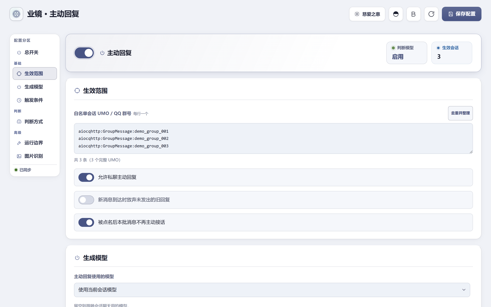
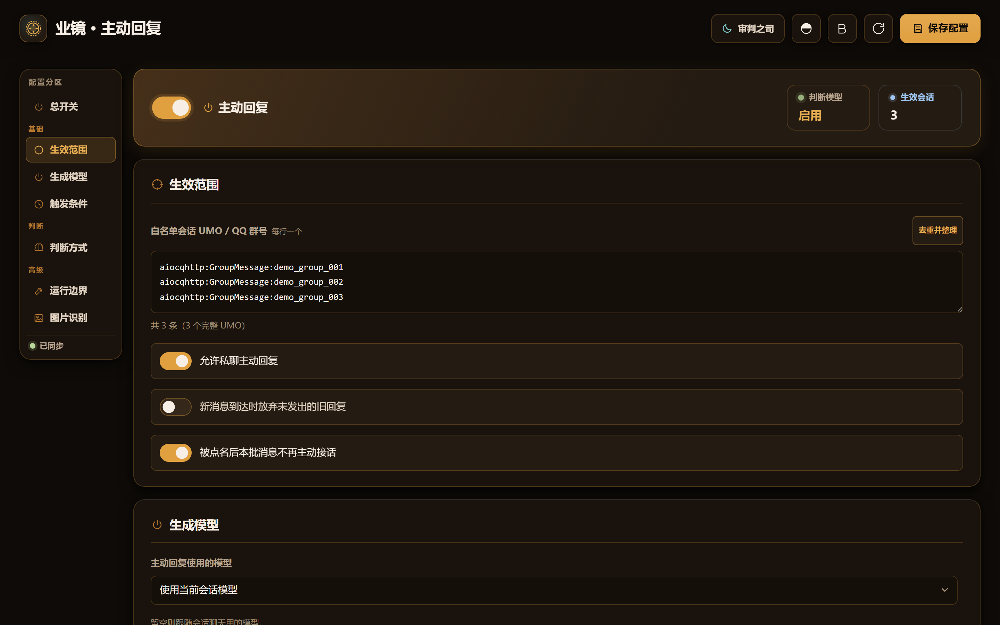

<p align="center">
  <picture>
    <source media="(prefers-color-scheme: dark)" srcset="https://raw.githubusercontent.com/chengzhi-c/astrbot_plugin_self_initiated_reply/main/assets/banner-dark.jpg">
    <source media="(prefers-color-scheme: light)" srcset="https://raw.githubusercontent.com/chengzhi-c/astrbot_plugin_self_initiated_reply/main/assets/banner-light.jpg">
    
  </picture>
</p>

<h1 align="center">业镜 · 主动回复</h1>

<p align="center">
  让 AstrBot 在白名单会话中主动接话的插件。<br>
  
  
</p>

<p align="center">
  <a href="#-简介">简介</a> · <a href="#-安装">安装</a> · <a href="#-工作方式">工作方式</a> · <a href="#-工具边界">工具边界</a> · <a href="#-设置页面">设置页面</a> · <a href="#-指令">指令</a> · <a href="#-english">English</a>
</p>

---

## 📖 简介

> **业镜**（名字取自《阴阳师：百闻牌》中阎魔卡牌「业镜」）为 AstrBot 提供白名单会话内的主动接话能力。

- 收到消息后等待对话静默，再由判断模型评估是否接话。
- 主动回复由 AstrBot 主 Agent 管线生成，默认不开放任何工具。
- `@Bot`、唤醒词与指令保持原有回复逻辑，两套流程互相独立。

---

## 📦 安装

需要 AstrBot `>= 4.23.3, < 5` 与 Python `>= 3.12`。

- 从 Releases 下载最新 zip。
- 控制台「插件」→「安装插件」→ 上传该 zip。

---

## 🚀 工作方式

1. **收集**：监听白名单会话中的普通消息，等待对话进入静默期。
2. **判断**：调用判断模型评估当前氛围，返回接话判定与原因：
   ```json
   {"should_reply": true, "reason": "群友提到了感兴趣的话题"}
   ```
3. **回复**：判断通过后，由 AstrBot 主 Agent 生成回复内容并发往会话。

回复模型默认跟随当前会话，回退顺序继承会话配置。在「主动回复使用的模型」「主动回复的备用模型」「主动回复的单模型请求尝试次数」里设了值就以设置为准，备用列表会替换会话的回退链。

请求尝试次数含首次请求，默认 1 表示超时即切下一个模型。所有模型失败时结束这一轮，并在日志中记录原因。

---

## 🔒 工具边界

主动回复默认不开放任何工具权限。

开启「允许继承插件工具」后会放行宿主与插件工具，但 Shell / Python 代码执行、浏览器与电脑操作、定时任务、文件提取、知识库代理等宿主危险能力仍被移除。

---

## 🖼️ 图片识别（可选）

默认关闭。开启后，可感知对话中近期发送的图片：

- **独立开关**：支持分别控制判断模型与主模型的识图功能。
- **识图 Provider**：判断阶段的识图跟随判断模型本身，可以单独指定更便宜的识图模型；主阶段识图走「识图模型」设置。
- **表情包跳过**：默认关闭。开启后跳过平台标记为表情包的图片。
- **本地缓存**：相同图片在有效期内复用解析结果。

---

## ⚙️ 设置页面

宿主支持插件自定义页面时，在 AstrBot 插件详情中即可打开可视化设置页（较低版本如 4.23.3 不显示该页，用插件配置表单修改同样的键）。页面需在 AstrBot 控制台内打开，直接双击 `index.html` 会停在「脚本加载失败」。页面支持浅色「慈爱之惠」与深色「审判之司」双主题：

<p align="center">
  
  
</p>

<p align="center">
  
  
</p>

### 常用配置项

插件配置共 44 个键。下表是常用的 16 个，其余在设置页「主动回复设置」或 AstrBot 原生配置表单里逐项可改。

主动回复用哪个模型、失败后试哪几个、每个模型最多请求几次，在设置页的「生成模型」里单独选。次数含首次请求，模型从 AstrBot 已有的 provider 里选。都留空时沿用会话聊天用的模型和 AstrBot 里配置的备用顺序。单模型请求次数只在 AstrBot 4.27 及以上生效。

| 配置项 | 推荐值（默认值） | 说明 |
| --- | --- | --- |
| 启用判断模型 `decision_model_enabled` | 开启 | 关闭后只保留巡检与手动检查 |
| 判断模型 Provider `judge_provider_id` | 留空或轻量模型 | 留空时跟随会话模型 |
| 生成时限 `generation_timeout_sec` | `300` 秒（默认 `300`，上限 `600`） | 单次主动生成的等待上限。按候选链各模型的请求超时与尝试次数估算，宿主的重试间隔会再延长等待 |
| 判断温度 `decision_temperature` | `0.1-0.4`（默认 `0.2`） | 越低越稳定 |
| 判断提示词 `decision_prompt_template` | 默认模板 | 支持 `{latest_message}`、`{recent_messages}`、`{session}`、`{bot_aliases}` 等变量 |
| 判断模型超时 `decision_timeout_sec` | `10-60` 秒（默认 `20`） | 判断模型单次调用的等待上限，超时按不接话处理，这一轮不产生回复 |
| 最少上下文消息数 `decision_history_min_messages` | `5-10` 条（默认 `5`） | 本地文本记录少于此数时读宿主会话历史补齐。判断提示词至少取最近 8 条，0 表示只用本插件缓存 |
| 最小静默秒数 `min_silence_sec` | `45-120` 秒（默认 `45`） | 0 表示不要求静默。实际等待取本项与「消息后延迟」的较大值 |
| 消息后延迟 `message_delay_sec` | `30-120` 秒（默认 `60`） | 与最小静默取较大值，作为收到消息后的最短等待时间 |
| 冷却秒数 `cooldown_sec` | `300-900` 秒（默认 `900`） | 0 表示不限制 |
| 新消息到达放弃旧回复 `abandon_stale_on_new_message` | 视场景开启（默认关） | 只作用于尚未发出的回复 |
| 被点名后本批消息暂停接话 `skip_after_direct_call` | 开启 | 下一条新消息到达即恢复 |
| 主动回复引用消息 `quote_mode` | 不引用（默认）/ 由判断模型决定 / 按概率 | 引用这一轮回复依据的最后一条消息。取不到消息 ID 或不支持的平台降级为普通发送 |
| 引用概率 `quote_probability` | `30-70` %（默认 `50`） | `random` 模式每次都按此概率。`model` 模式下判断模型未表态时兜底（0 从不、100 每次） |
| 主动回复 @ 对方 `mention_mode` | 不 @（默认） | `always` @ 这一轮回复依据那条消息的发送者，`random` 按 @ 概率。与「引用消息」互相独立，可同时开启。取不到发送者 ID 或不支持 @ 的平台降级为普通发送 |
| @ 概率 `mention_probability` | `30-70` %（默认 `50`） | 仅在「主动回复 @ 对方」为 `random` 时生效（0 从不、100 每次） |

`enabled_private_sessions` 默认开启，关闭后只对群聊主动开口。

`proactive_inherit_tools` 默认关闭。开启后主动回复与 @Bot 共用同一套工具（发图、记忆、搜索等），Shell / Python、浏览器、定时任务等宿主危险能力仍被移除。群聊普通消息会间接触发继承来的工具，仅在你信任群聊环境时开启。

---

## 🎯 关于白名单

会话需加入白名单后才会触发主动回复：

- 在目标群发送 `/selfreply add`，即可将当前会话加入白名单。
- 设置页「生效范围」支持批量编辑。群聊可填完整会话标识（UMO，`/selfreply status` 可查）、纯群号，或非 QQ 平台的会话键（如 Telegram 负数 `chat_id`、飞书 `oc_` 开头的会话 ID，摘要里显示为「群键」）。私聊需填写完整会话标识。
- 设置页保存前会拒绝缺段或含空白的条目。AstrBot 原生配置表单按原样接受这些条目，填错时对应会话不会触发主动回复。
- 「允许私聊主动回复」控制私聊场景的触发。

---

## 📋 指令

| 指令 | 说明 |
| --- | --- |
| `/selfreply` | 查看指令帮助 |
| `/selfreply status` | 查看当前会话状态、配置与白名单概况 |
| `/selfreply add` / `remove` | 将当前会话加入 / 移出白名单 |
| `/selfreply list` | 私聊中查看完整白名单；群聊中仅显示数量 |
| `/selfreply check [内容]` | 手动触发一次接话检测，不调用判断模型，并先取消本会话正在跑的那次 |
| `/selfreply on` / `off` | 启用 / 暂停主动回复（配置持久化保存，重启依然生效） |
| `/selfreply debug` | 查看当前消息的唤醒、忽略发送者与直接点名识别结果 |

以上指令仅管理员可用。非管理员的 `@Bot selfreply help` 仍可取到帮助。

---

## 🛠️ 故障排查

若遇到未按预期主动回复的情况，可依次检查：

1. 发送 `/selfreply status`，确认当前会话已在白名单内且插件处于开启状态。
2. 若在私聊测试，确认已开启「允许私聊主动回复」。
3. 确认已过去「消息后延迟」与「最小静默」中较大的秒数，且不在冷却期内。
4. 查看最近一次判断的结论与原因（后台日志里的 `should_reply` 字段）。
5. 使用 `/selfreply check 测试` 手动跑通生成与投递。

若主动回复过于频繁：确认「冷却」与插件配置表单里的「单会话每日上限」取值大于 0（0 表示不限制），或调大「最小静默」与「消息后延迟」。`/selfreply status` 的「最近一次判断」一行会显示本会话最近一次判断的时间、结论（接话/不接话）与原因。

> 网络必须能直连图片地址：走代理时识图会静默失败，回复退化为纯文本。

> 日志按 `session=<会话标识>` 查单个会话，按 `ledger_id=` 串联一次回复的全过程。

---

## 🔐 安全提示

插件设置页与相关接口依赖 AstrBot 控制台本身的权限验证，请将 AstrBot 管理端口部署在受信任的网络环境中。

### 数据与隐私

- 消息原文与发送者昵称随判断请求和生成请求发给对应的模型服务商；判断模型与主动回复模型分开配置时，两者都会收到。启用识图时图片另发给识图模型。
- `plugin_data/<插件名>/state.json`：明文保存最近 `recent_message_limit` 条消息原文、群昵称、机器人自己发出的回复，单条按原文存，滚动覆盖。
- `plugin_data/<插件名>/ui_prefs.json`：设置页主题、压暗与粗体偏好。
- `data/config/<插件名>_config.json`：插件配置，含白名单、忽略发送者 ID、自定义提示词和模型标识等。
- `plugin_data/<插件名>/image_cache/`：开启识图后群友图片的原文件，按 `vision_image_age_sec` 清理；识别时图片会发给识图模型。
- 日志：默认日志包含会话标识和模型判断理由；开启 `log_reply_content` 后，发送成功的 DEBUG 日志还会带回复正文前 80 字符。文件读写错误日志也可能包含本机路径。
- 删除顺序：先停用插件或重启宿主，再删 `plugin_data/<插件名>/` 与 `data/config/<插件名>_config.json`。
- `state.json.corrupt-*`、`state.json.unreadable-*`、`state.json.unmigrated-*` 与 `<插件名>_config.json.corrupt-*` 备份也可能含这些数据。
- 运行中落盘会重建状态、偏好文件与目录。

---

## 🌐 English

An AstrBot plugin that enables your bot to naturally join conversations in whitelisted sessions.

- **Silence Detection**: Waits for active chat to pause before evaluating.
- **Two-Stage Architecture**: A lightweight judge model evaluates whether to respond, and the main AstrBot agent generates the reply.
- **Restricted Sandbox**: No tools are available during proactive replies by default; enabling plugin-tool inheritance exposes host and plugin tools while shell/Python, browser, cron, file and KB capabilities stay disabled.
- **Optional Vision**: Reads recent images when enabled, with caption caching and an opt-in sticker skip.
- **Web Settings Page**: Built-in Light and Dark themes for managing whitelist, cooldowns, and judge prompts.

Commands: `/selfreply` · `status` · `add` · `remove` · `list` · `check [text]` · `on` · `off` · `debug`

---

## 📄 开源许可

本项目采用 [GPL-3.0](LICENSE) 开源。
